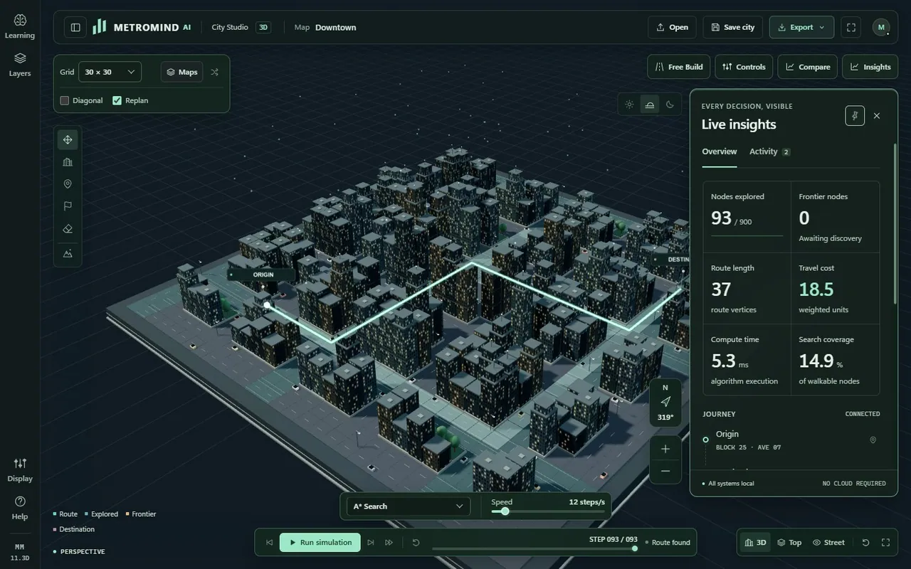
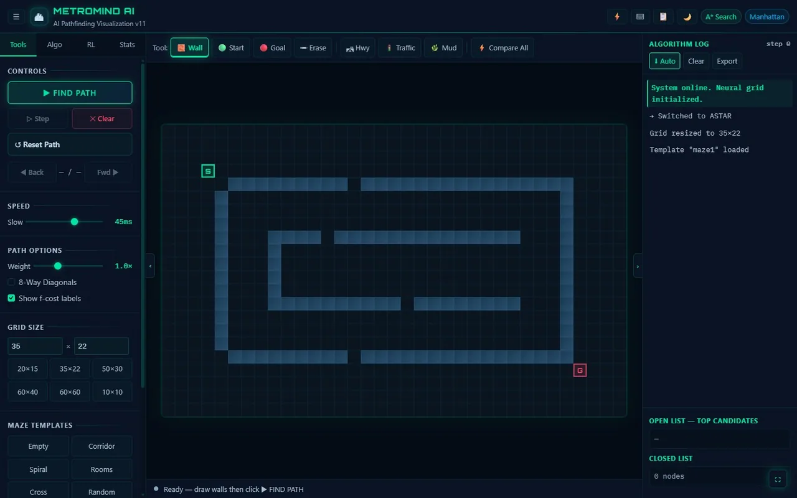

# MetroMind AI

MetroMind AI is a browser simulator for pathfinding and reinforcement learning. Compare nine search algorithms on the same map, change roads or obstacles to watch D* Lite repair a route, and train a Q-learning agent to find its own way. Choose the 2D grid for inspecting individual search steps or 3D City Studio for exploring and editing a procedural city.

## Interactive previews

Expand or collapse each preview by clicking its title. Click an image to see it at full size. To run the simulator and edit the map yourself, download the standalone HTML below the preview and open it in a browser.

<details open>
<summary><strong>3D City Studio · Explore a completed route</strong></summary>

[](docs/media/city-studio.webp)

Orbit the city, draw roads and buildings in **Free Build**, and inspect routes with **Insights**. Try **Run simulation** on the default Downtown map, then drag the city to change your view.

[Standalone 3D HTML](MetroMind%20AI%203D.html) · [3D controls and development guide](3d/README.md)

</details>

<details open>
<summary><strong>2D Grid Lab · Watch A* explore a corridor maze</strong></summary>

[](docs/media/grid-lab.webp)

Draw walls and weighted terrain, step backward through search history, and compare all nine algorithms with **X**. For a live reroute, select **D* Lite**, click **Find Path**, and draw a wall across the route.

[Standalone 2D HTML](MetroMind_AI_v11.html) · [2D modular development guide](modular_version/README.md)

</details>

## Run locally

Download or clone this repository and open either standalone HTML file in a modern browser. Both embed the code needed to run offline. The 3D edition requires WebGL.

| Edition | Standalone file | Editable source |
| --- | --- | --- |
| 3D City Studio | [MetroMind AI 3D.html](MetroMind%20AI%203D.html) | [3d/](3d/) |
| 2D Grid Lab | [MetroMind_AI_v11.html](MetroMind_AI_v11.html) | [modular_version/](modular_version/) |

## What you can try

- **Compare search strategies.** Run A*, Dijkstra, bidirectional search, BFS, DFS, greedy best-first search, Jump Point Search, Theta*, and D* Lite. Use the comparison view to see how search effort and route cost change across algorithms.
- **Experiment with route costs.** Paint highways (0.5×), heavy traffic (3×), or mud (10×). City Studio also lets you edit elevation. Use D* Lite to see how changing obstacles and costs affects an existing route.
- **Train a Q-learning agent.** Adjust learning parameters, follow reward trends, and inspect the learned policy with arrows and Q-value overlays. City Studio can also show learned values as columns above the map.
- **Inspect and export runs.** Pause, step through search history, export run statistics as CSV, and save a map as JSON to revisit it later.

| Shortcut | Action |
| --- | --- |
| Space | Start or pause search |
| X | Open algorithm comparison |
| S / B | Step forward or backward through the search |
| R | Reset the current route |
| G | Focus on the map |
| ? | Open the edition's shortcut guide |

## Develop and rebuild

Edit the source directory for your edition and regenerate its standalone file. To serve both source editions for local development, run this command from the repository root:

```powershell
python -m http.server 8000
```

Open [3D City Studio](http://localhost:8000/3d/) or the [2D Grid Lab](http://localhost:8000/modular_version/MetroMind_AI_v11.html) after starting the server.

For **3D City Studio**, build and check the standalone file from the repository root:

```powershell
node 3d/scripts/build.cjs
node 3d/scripts/build.cjs --check
```

For **2D Grid Lab**, build, check parity, and run the tests:

```powershell
cd modular_version
npm ci
npm run build
npm run check:parity
npm test
```

See the [3D development guide](3d/README.md#edit-and-rebuild) and [2D synchronization guide](modular_version/README.md#keep-both-editions-synchronized) for source layouts and validation commands.

## Roadmap

- [x] D* Lite dynamic replanning
- [x] 3D City Studio with a standalone offline build
- [ ] Multi-agent coordination and collision avoidance
- [ ] GIS data ingestion for real-world maps
