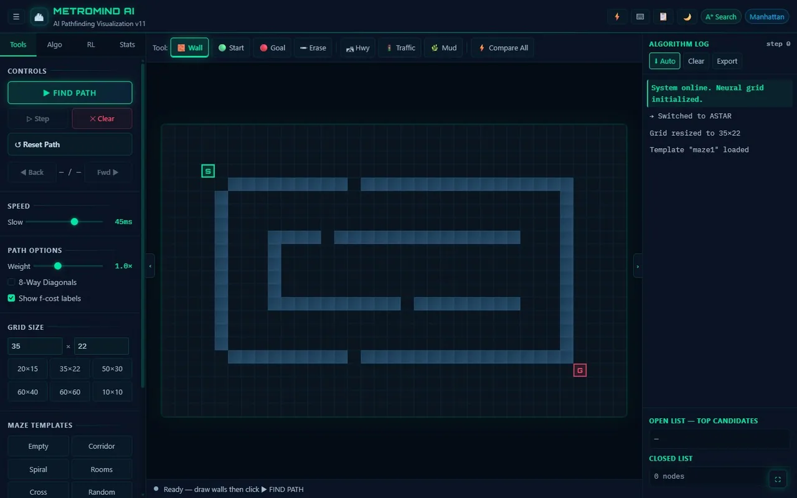
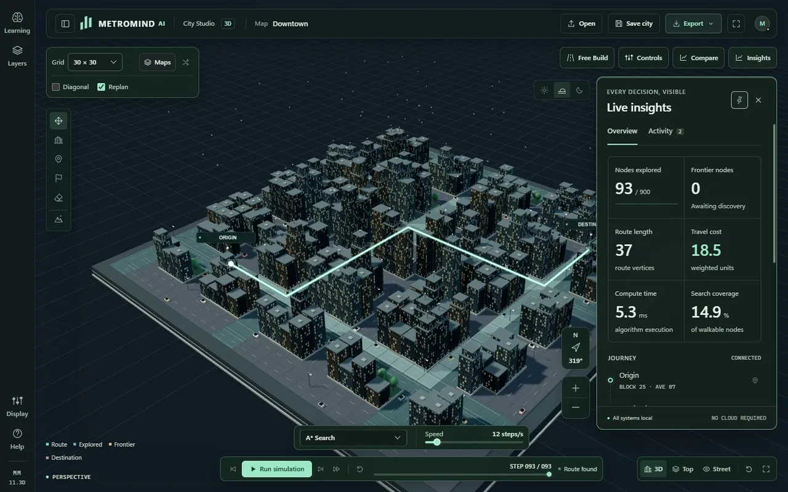

# MetroMind AI

MetroMind is a browser simulator for pathfinding and reinforcement learning. Replay a search on the same map in **2D Grid Lab** and **3D City Studio**, then open either simulator to edit the map, compare algorithms, or train a Q-learning agent.

[Open the live dashboard](https://ayaan-22.github.io/MetroMind-AI/)

## Explore the dashboard

- **Replay a route.** Choose one of nine algorithms and select **Replay search** to watch the search unfold across a 2D grid and a live 3D model of Downtown.
- **Explore the city.** Drag to orbit, cycle through dusk, night, and day, or pause scene motion. When WebGL is unavailable, the dashboard shows a City Studio screenshot alongside the 2D replay.
- **Read the results.** The dashboard reports visited cells, route waypoints, and weighted cost. Theta* can connect distant waypoints in a single segment. The **Algorithm capabilities** table compares search strategies, path guarantees, and replanning behavior.

## Choose an edition

| Edition | What you can do | Offline file | Source |
| --- | --- | --- | --- |
| **2D Grid Lab** | Draw walls and weighted terrain, step through search history, and compare routes and explored cells on a flat grid. | [metromind-2d.html](metromind-2d.html) | [Grid Lab guide](2d/README.md) |
| **3D City Studio** | Orbit a procedural city, build streets and adjust elevation in **Free Build**, and inspect routes and live search metrics. | [metromind-3d.html](metromind-3d.html) | [City Studio guide](3d/README.md) |

Both editions share the dashboard’s dark mint theme, skyline mark, and typography. Grid Lab also offers a light theme.

<details>
<summary><strong>Recorded demo · 2D Grid Lab</strong></summary>

[](docs/media/grid-lab.webp)

</details>

<details>
<summary><strong>Recorded demo · 3D City Studio</strong></summary>

[](docs/media/city-studio.webp)

</details>

## Run locally

Download either standalone HTML file and open it in a modern browser. Each file includes its styles and application code. City Studio requires WebGL.

To use the landing dashboard locally, clone or download the repository and open [index.html](index.html) with its adjacent assets. To serve the repository over HTTP, run this command from its root.

```powershell
python -m http.server 8000
```

Open the [landing dashboard](http://localhost:8000/), [2D Grid Lab source](http://localhost:8000/2d/), or [3D City Studio source](http://localhost:8000/3d/).

## What you can try

- **Compare all nine searches.** Run A*, Dijkstra, bidirectional search, BFS, DFS, greedy best-first, Jump Point Search, Theta*, and D* Lite against the same map.
- **Change route costs.** Paint highways (0.5×), traffic (3×), or mud (10×). City Studio also models additional uphill cost.
- **Reroute with D* Lite.** Run a route in either simulator, then block a street or change a terrain cost to watch the search repair it.
- **Train a Q-learning agent.** Follow rewards and inspect the learned policy. City Studio can also show Q-values as columns above the map.
- **Inspect and export a run.** Pause or step through search history, download run statistics as CSV, and export map layouts as JSON.

### Simulator shortcuts

| Key | Action |
| --- | --- |
| `Space` | Start or pause search |
| `X` | Compare algorithms |
| `S` / `B` | Step forward or backward |
| `R` | Reset the route |
| `G` | Focus on the map |
| `?` | Open the edition’s shortcut guide |

## Develop and rebuild

Edit [theme.css](theme.css) at the repository root to change the shared palette, typography, or skyline mark. Each simulator build copies it into its own CSS folder and embeds it in the standalone HTML. Rebuild both editions after a shared theme change.

Run the City Studio build and tests from the repository root.

```powershell
node 3d/scripts/build.cjs
node 3d/scripts/build.cjs --check
node --test 3d/tests/*.test.cjs
```

Use Node.js 22 or later for the Grid Lab build and tests.

```powershell
cd 2d
npm ci
npm run build
npm run check:parity
npm test
```

See the [3D build guide](3d/README.md#edit-and-rebuild) and [2D build guide](2d/README.md#keep-both-editions-synchronized) for source layouts and test coverage.

## Roadmap

- [x] D* Lite dynamic replanning
- [x] 3D City Studio with a standalone offline build
- [ ] Multi-agent coordination and collision avoidance
- [ ] GIS data ingestion for real-world maps

See [ROADMAP.md](ROADMAP.md) for details.
